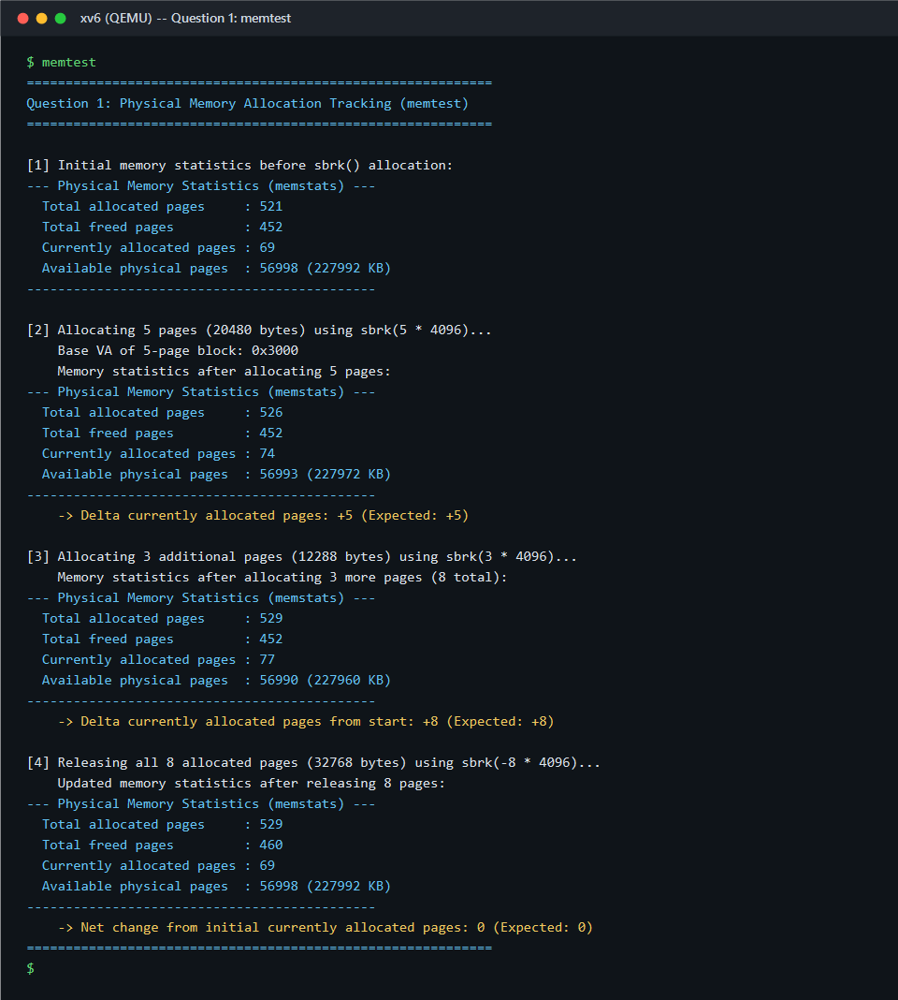
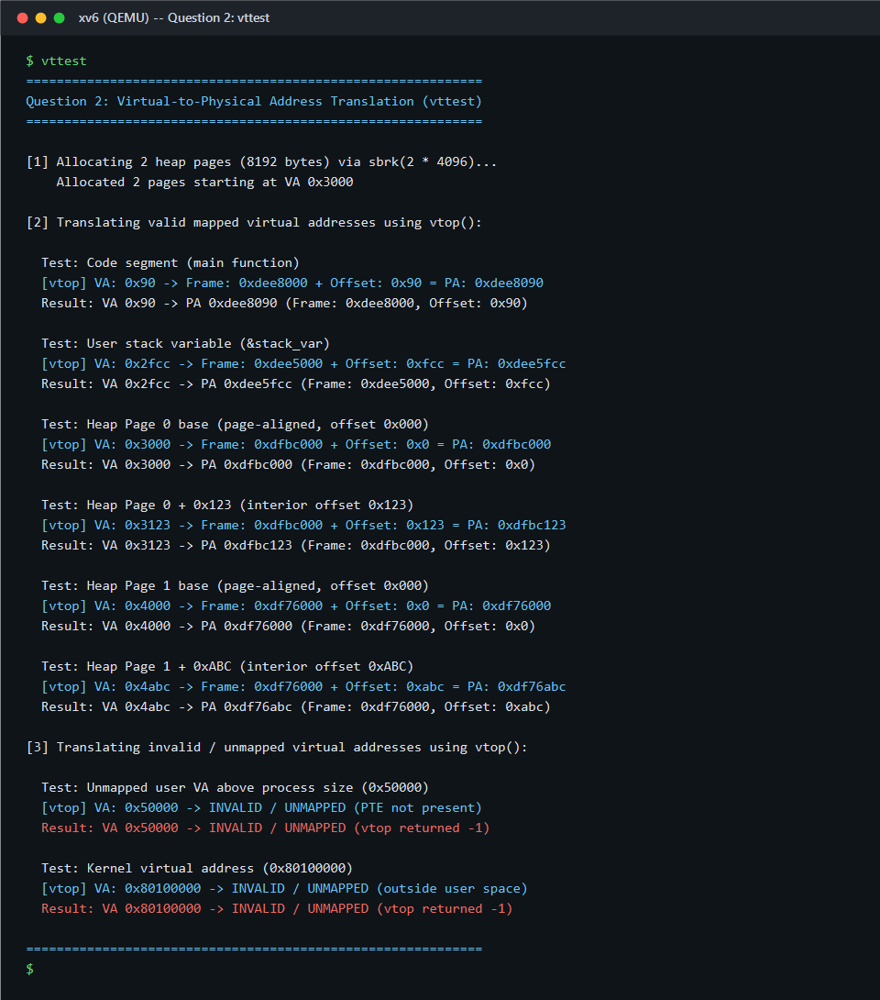
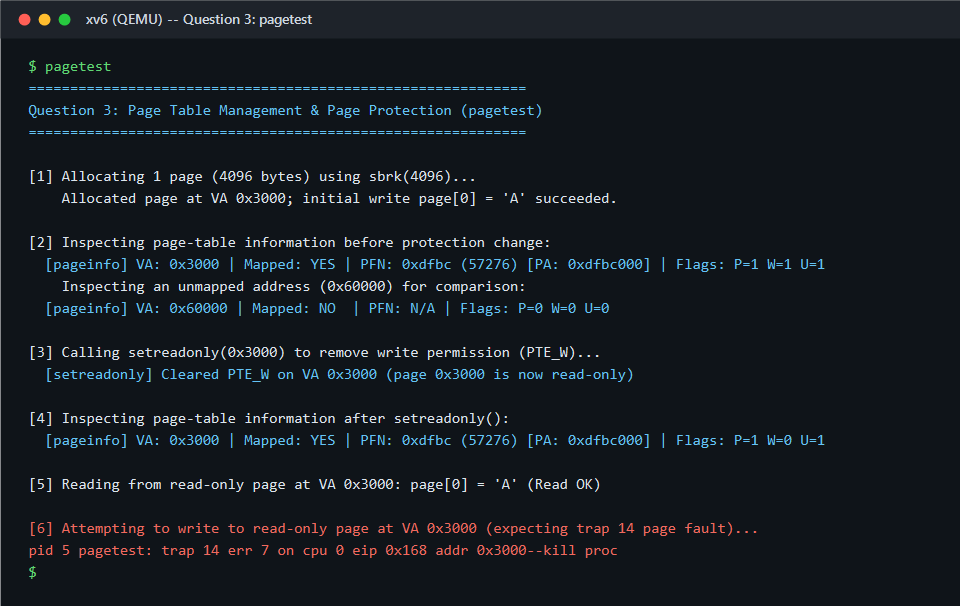
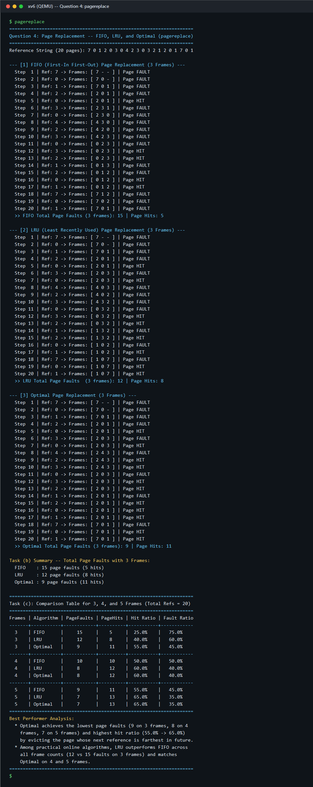

# Operating Systems — Assignment 10 Report
## Physical Memory Tracking, Virtual-to-Physical Translation, Page Protection, and Page Replacement (FIFO, LRU & Optimal) in xv6

- **Student Name**: Nishchay  
- **Roll Number**: 2401mc22  
- **Repository**: `Assignment10-2401mc22`  
- **Target Platform**: MIT xv6 (x86 32-bit Two-Level Paging) on QEMU  

---

## Question 1 — Memory Management: Tracking Physical Memory Allocation (`memstats` & `memtest.c`)

### 1. Implementation & Kernel Modifications
- **`kalloc.c` (`kalloc`, `kfree`, `freerange`, `memstats`)**:
  - Extended `struct kmem` with `uint total_allocated`, `uint total_freed`, `uint free_pages`, and `int initializing`, all initialized to `0` in `kinit1()`.
  - During boot-time physical memory discovery (`freerange()`), `kmem.initializing` is set to `1` so that pages added to `kmem.freelist` populate `kmem.free_pages` without artificially inflating `total_freed`.
  - Every successful call to `kalloc()` increments `kmem.total_allocated` and decrements `kmem.free_pages` under `kmem.lock`. Every runtime call to `kfree()` increments `kmem.total_freed` and `kmem.free_pages`.
  - Implemented `int memstats(void)` (registered as `SYS_memstats = 22` in `syscall.h`, `syscall.c`, `sysproc.c`, `defs.h`, `user.h`, and `usys.S`), which traverses `kmem.freelist` under `kmem.lock` to verify `avail_pages`, computes `curr_alloc = total_allocated - total_freed`, prints all four metrics, and returns `curr_alloc`.

### 2. Observations from Output (`memtest.c`)

- **Baseline**: Before heap growth, `memstats()` reports `521` total allocated pages, `452` total freed pages, `69` currently allocated pages, and `56998` available physical pages (`227992 KB`).
- **After `sbrk(5 * 4096)` and `sbrk(3 * 4096)`**: `Total allocated pages` increases by `5` (`526`) and then by `3` (`529`), `Currently allocated pages` rises from `69` to `74` (`+5`) and `77` (`+8`), and `Available physical pages` decreases correspondingly to `56993` and `56990`.
- **After `sbrk(-8 * 4096)`**: `deallocuvm()` frees all 8 pages via `kfree()`, raising `Total freed pages` from `452` to `460` (`+8`) and restoring `Currently allocated pages` to `69` and `Available physical pages` to `56998`.

---

## Question 2 — Virtual Memory: Virtual-to-Physical Address Translation (`vtop` & `vttest.c`)

### 1. Implementation & Kernel Modifications
- **`vm.c` (`walkpgdir`, `vtop`) & `sysproc.c` (`sys_vtop`)**:
  - Exposed `walkpgdir()` non-static in `vm.c` and declared it in `defs.h`.
  - Implemented `int vtop(int virtual_address)` (`SYS_vtop = 23`). It checks that `va < KERNBASE`, calls `walkpgdir(curproc->pgdir, (const void*)va, 0)` with `alloc = 0`, and verifies `pte != 0 && (*pte & PTE_P) != 0`.
  - When valid and present, `vtop()` extracts the 20-bit physical frame base `frame_addr = PTE_ADDR(*pte)` (`*pte & ~0xFFF`) and combines it with the 12-bit page offset `offset = va & 0xFFF` to return `pa = frame_addr | offset`. For unmapped or invalid addresses, it logs a diagnostic and returns `-1`.

### 2. Observations from Output (`vttest.c`)

- **Mapped Addresses**: `vttest` allocates 2 heap pages at `0x3000` and `0x4000` and translates code (`0x90 -> 0xdee8090`), stack (`0x2fcc -> 0xdee5fcc`), Heap Page 0 (`0x3000 -> 0xdfbc000`, `0x3123 -> 0xdfbc123`), and Heap Page 1 (`0x4000 -> 0xdf76000`, `0x4abc -> 0xdf76abc`). In every case, the lower 12-bit page offset (`0x90`, `0xfcc`, `0x123`, `0xabc`) is preserved identically between VA and PA while the upper 20 bits reflect the physical frame allocated by `kalloc()`.
- **Unmapped/Invalid Addresses**: Passing `0x50000` (above `myproc()->sz`) and `0x80100000` (kernel space) causes `vtop()` to detect the missing/invalid mapping and return `-1`.

---

## Question 3 — Paging: Page Table Management and Page Protection (`pageinfo`, `setreadonly` & `pagetest.c`)

### 1. Implementation & Kernel Modifications
- **`vm.c` (`pageinfo`, `setreadonly`)**:
  - `int pageinfo(int virtual_address)` (`SYS_pageinfo = 24`) locates the PTE via `walkpgdir(curproc->pgdir, (const void*)va, 0)`. If mapped (`*pte & PTE_P`), it computes `PFN = PTE_ADDR(*pte) >> 12` and prints mapping status, PFN, physical frame address, and hardware flags `P`, `W`, and `U`.
  - `int setreadonly(int virtual_address)` (`SYS_setreadonly = 25`) locates the PTE via `walkpgdir()`, clears the write-permission bit (`*pte &= ~PTE_W`), and reloads `CR3` via `lcr3(V2P(curproc->pgdir))` to flush stale TLB entries so the CPU immediately enforces `W=0`.

### 2. Observations from Output (`pagetest.c`)

- Before calling `setreadonly()`, `pageinfo(0x3000)` reports `Mapped: YES | PFN: 0xdfbc (57276) [PA: 0xdfbc000] | Flags: P=1 W=1 U=1`, whereas unmapped address `0x60000` reports `Mapped: NO | Flags: P=0 W=0 U=0`.
- After `setreadonly(0x3000)`, `pageinfo(0x3000)` confirms the flag change to `Flags: P=1 W=0 U=1` on the same physical frame (`PFN: 0xdfbc`).
- Reading `page[0]` succeeds (`'A'`), but attempting to write `page[0] = 'B'` triggers hardware **Trap 14 (`T_PGFLT`)** with error code `7` (user-mode write protection violation at `addr 0x3000`), causing the kernel to terminate the offending process (`pid 5 pagetest: trap 14 err 7 ... addr 0x3000--kill proc`).

---

## Question 4 — Page Replacement Algorithms: FIFO, LRU and Optimal (`pagereplace.c`)

### 1. Algorithms Implemented (`pagereplace.c`)
- **FIFO (First-In First-Out)**: Maintains a circular queue pointer (`fifo_ptr = (fifo_ptr + 1) % nframes`) to evict the oldest resident page upon a fault.
- **LRU (Least Recently Used)**: Records the most recent reference index `last_used[j] = i` on every hit or load and evicts the resident page with the minimum `last_used` timestamp.
- **Optimal (Belady's Algorithm)**: Scans future references `refs[i+1 .. nrefs-1]` for each resident frame and evicts the page whose next use is farthest in the future (or never referenced again).

### 2. Comparison Table & Observations (`7 0 1 2 0 3 0 4 2 3 0 3 2 1 2 0 1 7 0 1`)

| Frames | Algorithm | Page Faults | Page Hits | Hit Ratio | Page Fault Ratio |
| :---: | :--- | :---: | :---: | :---: | :---: |
| **3** | **FIFO** | 15 | 5 | 25.0% (`5/20`) | 75.0% (`15/20`) |
| **3** | **LRU** | 12 | 8 | 40.0% (`8/20`) | 60.0% (`12/20`) |
| **3** | **Optimal** | **9** | **11** | **55.0%** (`11/20`) | **45.0%** (`9/20`) |
| **4** | **FIFO** | 10 | 10 | 50.0% (`10/20`) | 50.0% (`10/20`) |
| **4** | **LRU** | **8** | **12** | **60.0%** (`12/20`) | **40.0%** (`8/20`) |
| **4** | **Optimal** | **8** | **12** | **60.0%** (`12/20`) | **40.0%** (`8/20`) |
| **5** | **FIFO** | 9 | 11 | 55.0% (`11/20`) | 45.0% (`9/20`) |
| **5** | **LRU** | **7** | **13** | **65.0%** (`13/20`) | **35.0%** (`7/20`) |
| **5** | **Optimal** | **7** | **13** | **65.0%** (`13/20`) | **35.0%** (`7/20`) |

- **Which Algorithm Performs Best**:
  1. **Optimal Page Replacement** performs best overall, achieving the theoretical minimum number of page faults (**9**, **8**, and **7** faults for 3, 4, and 5 frames) and highest hit ratios (**55.0%**, **60.0%**, and **65.0%**) because it looks ahead and retains pages (`0`, `1`, `2`, `3`) needed soonest while evicting pages (`7`, `4`) not needed for many steps.
  2. Among practical online algorithms (which do not know future references), **LRU** significantly outperforms **FIFO** at every frame count (**12 vs. 15** faults on 3 frames, **8 vs. 10** on 4 frames, **7 vs. 9** on 5 frames) and matches **Optimal** on 4 and 5 frames by exploiting temporal locality instead of blindly evicting heavily used pages like `0` and `2` simply because they arrived early.
